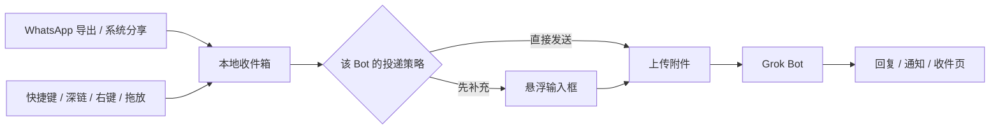

<div align="center">


<h1>grok-bot-whatsapp</h1>

<p><strong>把 WhatsApp 里导出的聊天，交给自己的 Grok Bot。</strong></p>

<p>WhatsApp 导出 · 系统分享 · Finder / 资源管理器 · 拖放 · 全局悬浮输入框</p>

<p>基于 <a href="https://github.com/RongleCat/grok-bot-anywhere">RongleCat/grok-bot-anywhere</a>（MIT）二次开发。</p>

<p>维护：左海 · <a href="https://github.com/shzharris">GitHub shzharris</a> · <a href="https://x.com/heizolshao">X @heizolshao</a></p>

<p>
<a href="docs/platforms/macos.md"></a>
<a href="docs/platforms/windows.md"></a>
<a href="docs/platforms/linux.md"></a>
<a href="desktop/package.json"></a>
<a href="package.json"></a>
<a href="LICENSE"></a>
</p>

<p><sub>macOS 主路径已实机验证 · WhatsApp 真实分享菜单、下载文件夹和文件夹选择器未实机验证 · Windows 部分实机验证（开发模式） · Linux 暂不支持</sub></p>

</div>

<picture>
  <source media="(prefers-color-scheme: dark)" srcset="docs/assets/screenshots/bots-dark.png">
  
</picture>

<p align="center"><sub>预览工作区：Bot 名单、每个 Bot 的接收设置与入口。</sub></p>

> [!IMPORTANT]
> 这是一个**非官方**客户端。它使用你自己的 Grok Bot 账号，与 xAI、WhatsApp 都没有合作、授权或背书。协议来自对本地客户端的观察，可能随上游更新失效。本应用不读取 WhatsApp 的本地数据库，也不登录 WhatsApp；只处理你主动导出或分享出来的文件。

## English

grok-bot-whatsapp sends a WhatsApp chat export to your own Grok Bot. It reads only files you export or share. It does not open WhatsApp's database or sign in to WhatsApp. This is an unofficial client, not affiliated with xAI or WhatsApp.

The interface follows the system language: Chinese when the locale is `zh-*`, otherwise English. **Settings → General → Language** can override that with Follow system, 中文, or English. The window, composer, tray, notifications, confirmations, and the Windows share picker switch immediately. macOS share-menu titles change on the next menu sync; WeChat caches that menu, so reopen WeChat. Edit and Window on the macOS menu bar stay with the system language.

## 它解决什么问题

聊天记录常常停在 WhatsApp 里：一次导出、一个 `_chat.txt`，或一个带着图片的 zip。这个应用把这些导出接到你指定的 Bot 上，并留下一条本地收件记录。系统分享、拖放和悬浮输入框也可以把内容送进来。它不是另一个聊天客户端，只做投递入口和收件箱。

## 适合谁

- 已经在用 Grok Bot，希望把 WhatsApp 导出的聊天交给它整理。
- 有多个 Bot 分工，想让 WhatsApp 和通用来源各自使用默认 Bot 和一段前缀。
- 在意投递结果，不接受「结果不明就自动重发」。
- 使用 macOS，或愿意在 Windows 上帮忙实机验证。

**不适合：** 需要 Linux 桌面支持、需要读取 WhatsApp 本机数据库，或只接受官方公开 API 的场景。

## WhatsApp 怎么用

导出步骤以 WhatsApp 官方说明为准：[如何导出聊天记录](https://faq.whatsapp.com/1180414079177245)。下面是接到本应用的路径。

1. 在 **WhatsApp（Mac 或 iPhone）** 里打开要导出的聊天，按官方说明导出。
   - 不含媒体时，通常得到 `_chat.txt`，或一个只含它的 zip。
   - 包含媒体时，得到一个 zip：里面是 `_chat.txt` 和图片、视频等文件。
   - iPhone 导出的文件用隔空投送、文件 App 或数据线带到 Mac。
2. 打开本应用，连接 Grok Bot 账号。
3. 在 **设置 → 常规 → 来源** 里，为 WhatsApp 选默认 Bot，并写一段前缀，例如 `整理要点、痛点和可做的选题`。通用来源可以另选一个 Bot、另写一段前缀。
4. 把导出文件交给应用，任选一种：
   - macOS：在 WhatsApp 或访达的系统分享里点 `发给 {Bot 名}`。WhatsApp 和通用来源共用这 12 个槽。
   - 把 `_chat.txt` 或 zip 拖到对应的 Bot 卡片上。
5. 应用识别导出格式后，收件会带上来源标记 `WhatsApp`、聊天名、参与者和时间范围，并把该来源的前缀放在正文前面。媒体会随 zip 一起附上；能展开的图片和文件会另外挂上。不是 WhatsApp 导出的分享走通用来源。

支持的导出形态包括：iOS 方括号样式和 Android 横线样式、12 小时制和 24 小时制、中文和英文系统行、从左到右标记和窄不换行空格、多行消息，以及 `<attached: …>`、`(file attached)`、`图像已省略` 这类附件占位。

设置里可以分别指定 WhatsApp 和通用来源的默认 Bot 与前缀。

### 自动导入下载文件夹

WhatsApp for Mac 导出后，会把 `WhatsApp Chat - 聊天名.zip` 直接存进「下载」文件夹，有时是一份 `_chat.txt`。在 **设置 → 常规** 打开「自动导入 WhatsApp 导出」后，应用监视这个文件夹。默认是 `~/Downloads`。点「选择文件夹」可以用系统的文件夹选择器换成别的目录，点「恢复为下载文件夹」回到默认。

打开之后才出现、并且已经写完的文件才会被检查。确认是 WhatsApp 导出后，交给 WhatsApp 的默认 Bot，前缀和从分享菜单导入时一样，并弹出一条通知。同一份文件不会导入第二次。未写完的下载（`.crdownload`、`.download`）和其他文件会被跳过。应用不会移动或删除这些文件。换文件夹会重新开始监视，文件夹里原来的文件不会再导入一次。

真实的 WhatsApp Mac 分享菜单、iPhone 导出传到 Mac 的整条路径、真实下载文件夹，以及系统文件夹选择器，还没有在实机上跑过。单测覆盖的是导出文件的识别、解析、导入，以及在临时目录里的监视逻辑。

## 快速开始

### 从源码运行（macOS）

```sh
git clone --recurse-submodules <repo-url>
cd <repo>
npm run setup
npm run build:native     # Touch Bar、原生输入框、语音
npm run build:share      # 系统分享菜单（WhatsApp 和通用来源共用）
npm run dev
```

首次打开：

1. 连接 Grok Bot 账号。
2. 选择一个 Bot，打开「接收转发」。
3. 在设置里为 WhatsApp 和通用来源指定默认 Bot 和前缀。
4. 按 `Control+Option+Space` 唤起悬浮输入框。
5. 导出一份 WhatsApp 聊天，分享或拖进应用。

### Windows

```powershell
npm run setup
npm run dev
```

Windows 没有 Swift 伴侣，也没有 macOS 那种按 Bot 分槽的分享扩展。可以把导出的 `_chat.txt` 或 zip 拖到 Bot 上，也可以用 Explorer 右键、悬浮输入框、URL 协议和 `grok-bot` 命令。这条 WhatsApp 文件路径没有在 Windows 实机上跑过。完整差异见 [Windows](docs/platforms/windows.md)。

### 从源码打包

```sh
npm run package:mac    # arm64 + x64 DMG，签名 + 公证
npm run package:win    # 未签名 zip
```

产物在 `desktop/release/`，不进入 git。Windows 包是未签名 zip。本仓库不附带上游项目的发布页。

## 功能

### 悬浮输入框

全局快捷键在任何应用上唤起（macOS `Control+Option+Space`，Windows `Ctrl+Alt+Space`）；回车发送，Shift+回车换行。输入法组字期间不会误发。Tab 打开 10×2 的 Bot 宫格，支持数字键、方向键、回车和 Esc。

macOS 上还可以用设备端中文语音输入；拖入文件时只登记路径，发送时才复制和上传。发送后输入框收起为带头像、进度条和状态的小条，关闭小条不会中止发送；附件超过 50 MB 会先确认。

<p align="center"></p>

### 界面语言

默认跟随系统：语言是 `zh-*` 时用中文，否则用英文。在 **设置 → 常规 → 语言** 可以选择「跟随系统」「中文」或 English。主窗口、输入框、托盘、通知和确认马上切换。macOS 分享菜单标题在下次同步后更换；微信会缓存菜单，需要重新打开。

### 分享菜单（macOS）

macOS 的分享扩展是通用的系统分享（`com.apple.share-services`）。WhatsApp 和访达的系统分享里，每个启用的接收 Bot 占一行。点哪一行就投给哪个 Bot。

分享扩展不能在运行时创建，所以预留 12 个签名槽位：第 1–12 个接收 Bot 进入菜单，第 13 个起仍可用悬浮输入框和拖放。

Windows 只有一个 `Grok Bot` 条目，点开后由应用内的 Bot 选择面板决定目标。

### 收件箱

每条交办都有状态：待补充、已发送、未确认、失败、过期。

- 内容先落到本地，再联网；断网或未登录不丢内容。
- 直接发送在创建后 90 秒内还没开始处理，标为过期，不补发；已经开始上传的不受这个时间限制。
- 发送结果不明确时进入「未确认」并暂停该 Bot，等你去官方客户端核对后再解锁。
- 失败的文件保留在本地，可以重试；不会自动重发。


### 每个来源、每个 Bot 的投递策略

- 收到后**直接发送**，或先放进输入框等你补充。
- 设置里，WhatsApp 和通用来源可以各自指定默认 Bot 和一段前缀。这段前缀会加在该来源的正文前，例如 `整理要点、痛点和可做的选题`。
- 直接发送时，Bot 自己的前缀仍会包在整段正文外面。
- WhatsApp 和通用来源可以分别开关。通用来源包含拖放和系统分享。
- 关掉某个 Bot 只停止新内容进入，不删除已有记录。

### 头像

Bot 的「更多」菜单里打开头像编辑器：26 个形状 × 11 个颜色全部可选，包含官方编辑器隐藏的南瓜；保存后直接写回账号。

### 命令行、skills 与深链

设置里可以安装 `grok-bot` 命令和随包 skill，让 Agent 用同一账号工作；macOS 上同时把 skill 链接给 Claude Code。

`grokbotanywhere://` 支持 `open`、`compose`、`send` 三种路由。带 `text` 的链接只预填，不自动发送；链接里不放 token。

## 工作原理



- **Electron 主进程**负责窗口、托盘、快捷键、深链和系统集成。
- **独立服务进程**是收件库、上传和发送队列的唯一写入者。WhatsApp 导出的识别也在这里完成。
- **Swift 原生伴侣**（仅 macOS）补 Touch Bar、原生输入框、语音、Finder 选区和分享扩展宿主。
- **渲染进程**没有 Node、没有凭据；所有动作走白名单 IPC。

架构与不变量见 [docs/architecture.md](docs/architecture.md)。

## 平台支持

| 平台 | 状态 | 说明 |
| --- | --- | --- |
| macOS 14+ | 主路径已实机验证 | 登录、名单、悬浮输入框、12 槽分享菜单、收件与发送、签名公证 DMG。WhatsApp 解析和文件夹监视有单测；真实分享菜单、真实下载文件夹和系统文件夹选择器未运行 |
| Windows 10/11 | 部分实机验证（开发模式） | 启动、主窗口、URL 协议、Explorer 级联、CLI、系统分享入口 + Bot 选择面板已在真机跑过；安装包、右键点击，以及 WhatsApp 文件拖入未运行 |
| Linux | 未支持 | 没有打包目标与平台适配 |

「已实现」只表示代码和单测存在。没跑过的项不写成已验证。细节见 [macOS](docs/platforms/macos.md)、[Windows](docs/platforms/windows.md) 与 [Linux](docs/platforms/linux.md)。

## 文档

文档按「给 Agent 接手」组织：先读入口，再按任务路由。

| 入口 | 内容 |
| --- | --- |
| [docs/README.md](docs/README.md) | Wiki 首页与任务路由 |
| [docs/architecture.md](docs/architecture.md) | 进程、数据流、仓库分层、不变量 |
| [docs/subsystems/](docs/subsystems/README.md) | 外壳、投递、分享菜单、原生伴侣、SDK、头像、打包 |
| [docs/runbooks/](docs/runbooks/build.md) | 构建、测试、发布、排障 |
| [docs/standards/](docs/standards/code.md) | 代码、测试、文档、提交规范 |
| [docs/decisions/](docs/decisions/0001-electron-over-swift.md) | 架构决策记录 |
| [AGENTS.md](AGENTS.md) | Agent 入口：命令、改哪里、完成定义 |
| [LESSONS.md](LESSONS.md) | 已踩过的坑与对应规则 |
| [llms.txt](llms.txt) | 给外部 LLM 的精简索引 |

## 开发

根 `package.json` 是跨平台命令门面：没有依赖，也没有 workspaces；依赖只装在 `desktop/`。

```sh
npm run setup          # desktop 依赖
npm run dev            # 构建 + 启动
npm run test           # desktop + client-protocol + avatar
npm run test:all       # 再加 Swift
npm run smoke          # 隔离冒烟，使用临时 workspace
npm run docs:check     # 校验 wiki 的 catalog、状态行和链接
```

`make` 目标转发同一组命令。`npm run dev` / `npm run smoke` 会自动剥掉 `ELECTRON_RUN_AS_NODE`，避免 Electron 被当成 Node 启动。

### 项目结构

```text
package.json              根命令门面（private、无依赖）
desktop/                  Electron 主产品
  src/main/               窗口、托盘、快捷键、深链、CLI、分享同步
  src/service/            收件库、上传、发送、账号会话、WhatsApp 导出解析
  src/renderer/           主窗口、悬浮输入框、Tab 宫格
  src/share/              macOS 分享槽位与注册
  src/shell/              跨平台纯函数
native/macos/             Swift 原生伴侣与头像（0.1.0 桥 + Bloub 回退）
packages/client-protocol  非官方协议 SDK / CLI
docs/                     Wiki、平台说明、runbook、规范、ADR
projects/                 本地项目工作区（默认不入库）
legacy/bridge/            早期 SDK 调研，不参与构建
scripts/                  文档校验、跨平台命令启动器、Agent runner
```

## 代码签名

Windows 分发首选 Microsoft Store：个人开发者账号免费，商店认证后重签 MSIX，用户安装没有 SmartScreen 警告，见 [Store 提交](docs/runbooks/store-submission.md)。侧载包通过 [SignPath Foundation](https://signpath.org/) 申请开源签名，或使用商业 OV 证书。macOS 发布包使用 Developer ID 签名并经 Apple 公证。签名状态以对应 release 的校验结果为准。

## 隐私与安全

- 收件库、附件副本和偏好保存在本机 `userData`；应用登录使用 Electron `safeStorage`，没有明文回退。
- 只有主动打开命令行开关时，才会为 `grok-bot` 另外保存一份明文登录；退出登录或关闭开关时删除。
- 分享扩展没有网络权限，只把内容写到本地 `ShareInbox`；服务进程校验后才导入。
- 不读取 WhatsApp 的本地数据库，不向其他应用注入代码，也不使用非官方登录库。只处理你主动导出或分享的文件。
- 日志和验收报告不记录 token、cookie、聊天正文或私有 Bot ID。
- 测试使用临时目录和注入的 transport，不读写真实账号、Keychain 或用户数据。

安全边界与数据位置见 [docs/reference/configuration.md](docs/reference/configuration.md) 和 [docs/subsystems/delivery-service.md](docs/subsystems/delivery-service.md)。漏洞报告方式见 [SECURITY.md](SECURITY.md)。

## 状态与路线图

macOS 主路径可用。还没完成的部分：

- [ ] WhatsApp for Mac 的真实分享菜单、iPhone 导出文件在 Mac 上的整条分享路径、真实下载文件夹自动导入，以及系统文件夹选择器。
- [ ] Windows 实机验证（剩余）：安装包首次启动、Explorer 右键点击、悬浮输入框焦点、托盘点击，以及 WhatsApp 导出文件拖入。已跑过的项见 [Windows](docs/platforms/windows.md)。
- [ ] Linux 桌面支持：先决定系统集成最低集，再补打包目标。
- [ ] Touch Bar 硬件和语音权限的回归。

未完成项不会在功能列表里写成「已支持」。

## 参与贡献

欢迎提交 issue 和 PR，尤其是 WhatsApp 导出样本的格式差异、Windows 实机报告和可复现的投递问题。不要提交真实聊天记录。

开始之前：

1. 读 [AGENTS.md](AGENTS.md) 和 [CONTRIBUTING.md](CONTRIBUTING.md)。
2. 一个 PR 只做一个目标；行为变化带上能复现的测试。
3. 平台相关的结论写明在哪台机器上跑过；没跑就写「未运行」。
4. 不要提交 token、cookie、真实聊天内容、私有 Bot ID 或签名材料。

## 许可

本项目代码以 [MIT](LICENSE) 许可发布。原始版权归 RongleCat；本分叉的维护者版权归左海。两条都保留在 `LICENSE` 里。

第三方组件遵循各自许可：Bloub 头像引擎为 MIT，许可随 `assets/bloub/LICENSE`；`grok-bot-avatar-engine` 为 MIT，许可随 `vendor/grok-bot-avatar-engine-0.1.0.tgz`；Electron、Node 与 `grok-bot-sdk` 遵循其各自仓库的许可。项目内的产品名、Bot 头像和截图仅用于说明。

## 致谢

- [RongleCat/grok-bot-anywhere](https://github.com/RongleCat/grok-bot-anywhere) — 本仓库基于该项目（MIT）二次开发。
- [Bloub](https://github.com/jeremy-prt/bloub) — macOS 原生头像渲染引擎（MIT）。
- [grok-bot-avatar-engine](https://github.com/RongleCat/grok-bot-avatar-engine) — Electron 与 Touch Bar 共用的头像渲染器移植（MIT）。
- [Electron](https://www.electronjs.org/) — 跨平台桌面外壳。
- [grok-bot-sdk](https://github.com/RongleCat/grok-bot-sdk) — Electron 侧的账号、名单、发送与回复订阅。

---

<p align="center"><sub>非官方项目，与 xAI、WhatsApp 无关联。Grok、WhatsApp 及相关名称为其各自权利人的商标。</sub></p>
